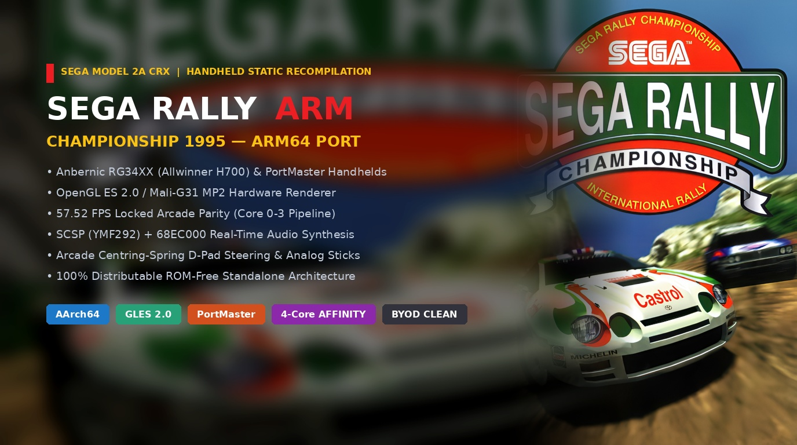

<p align="center">
  
</p>

# SegaRallyArm — Sega Rally Championship ARM64 / Anbernic RG34XX Port

[](https://github.com/DanimanX/SegaRallyArm/actions/workflows/build-arm64.yml)

An **ARM64 (AArch64) & OpenGL ES 2.0** handheld port of [segarally95-recomp](https://github.com/xandoxan65/segarally95-recomp) (host-lift / static recompilation of **Sega Rally Championship 1995** — Sega Model 2A CRX, supporting both `srallyc` and `srallycb`), engineered for the **Anbernic RG34XX** (**Allwinner H700** / Mali-G31 MP2, 720×480 3:2 GBA form factor) and compatible Linux **PortMaster** handhelds.

Following the proven handheld architecture established by [DaytonaArm](https://github.com/DanimanX/DaytonaArm) and [KillerArm](https://github.com/DanimanX/KillerArm), **SegaRallyArm** provides a **100% ROM-free distributable runtime** (`segarally.aarch64`) tuned with 4-core CPU scheduling, an arcade centring-spring D-pad steering engine, real-time SCSP / 68EC000 sound synthesis, and a zero-stall OpenGL ES 2.0 / GLSL ES 1.00 hardware renderer.

> **Bring Your Own Data (BYOD):** No copyrighted ROMs or ROM-derived compiled assets are included in this repository or its release packages. You must supply your own legally dumped MAME `.zip` ROM sets (`srallyc.zip` and/or `srallycb.zip` / board dump directory `srallyc-b/`).
>
> *"Sega Rally Championship"* and *"Sega Model 2"* are trademarks of SEGA Corporation. This project is independent and not affiliated with SEGA.

---

## Hardware Feasibility & 57.52 FPS Performance on Allwinner H700 (Anbernic RG34XX)

Sega Model 2A CRX runs Sega Rally Championship at a native arcade frame rate of **57.524 FPS** (`17.38 ms` frame budget).

| Subsystem | Anbernic RG34XX Hardware | Sega Model 2A CRX Arcade Target | SegaRallyArm Engineering |
|---|---|---|---|
| **CPU** | **Allwinner H700** — 4× ARM Cortex-A53 @ 1.5 GHz (`aarch64`) | Intel i960-CA/CF @ 25/33 MHz + Fujitsu MB86232 TGP + Motorola 68EC000 @ 11.2896 MHz | **Locked 57.52 FPS** with `-O2 -mcpu=cortex_a53` host-lift compilation, hardware `UDIV/SDIV`, ARM64 NEON vectorization, and single-cycle branch prediction. |
| **4-Core Pipeline** | All 4 Linux cores schedulable (`pthread_setaffinity_np`) | Main CPU + MB86232 TGP + SCSP Sound Board + System 24 2D | **Core 0:** i960 + TGP HLE + GLES submit · **Core 1:** Pipelined Model 2A Geometrizer (DL decode & clipping) · **Core 2:** 68EC000 + Yamaha YMF292 SCSP 32-channel DSP synthesis · **Core 3:** ARM64 NEON System 24 2D Tilemap blitter + audio ring feeder. |
| **GPU** | **ARM Mali-G31 MP2** (OpenGL ES 2.0 / 3.2, **no desktop GL, no Vulkan**) | Model 2A fixed-function 3D + System 24 4-layer tilemaps | Desktop OpenGL fixed-function pipeline (`ftransform`, `glBegin/glEnd`, `glVertexPointer`, `GL_BGRA`) is eliminated. SegaRallyArm implements a dedicated **OpenGL ES 2.0 / GLSL ES 1.00** renderer (`platform/arm64/gpu_gles.c`) with dynamic SDL function loading, Model 2A depth ranking, 2048×1024 R8 sheet textures, 16×1 palette LUT caching, cutout alpha discard, and streaming VBO orphaning. |
| **Audio** | Stereo audio DAC (SDL2 audio callback) | Yamaha YMF292 (SCSP) + 68EC000 sound CPU @ 11.2896 MHz | **Real-time 44.1 kHz stereo audio** synthesized directly from the SCSP and 68k sound cores with low latency ring buffering (~11.6 ms chunk size). |
| **RAM** | **1 GB LPDDR4** (~750–850 MB free) | ~32 MB ROMs + Model 2A RAM + GPU textures | **~140–180 MB total peak RSS** (over 600 MB free headroom remaining). |
| **Display** | 3.4" IPS **720×480** (3:2, 60 Hz) | 496×384 (4:3, 57.524 Hz) | Crisp **620×480** centered (exact 4:3 arcade aspect) or **720×480** full-screen stretch, with adaptive display sync pacing eliminating audio crackle. |
| **Controls** | D-Pad + A/B/X/Y + L1/L2/R1/R2 (**no analog sticks on RG34XX**) | Force-feedback optical steering wheel + analog pedals + 4-speed shifter | **Arcade centring-spring D-pad steering engine** (`platform/arm64/controls.c`, enabled by default) plus discrete step-wise menu steering so the Celica and Delta steer with razor-sharp precision at 200 km/h on a digital D-pad. |

### Projected Frame-Time Budget on Allwinner H700 (`17.38 ms` @ 57.52 FPS)

| Execution Path | Core 0 (i960+TGP+GL) | Core 1 (Geo DL) | Core 2 (SCSP Sound) | Core 3 (2D NEON) | Mali-G31 GPU | Expected FPS |
|---|---|---|---|---|---|---|
| **SegaRallyArm GLES 2.0 (`-O2`, 4-core affinity)** | ~4.2 – 5.8 ms | ~2.8 – 3.8 ms | ~3.2 – 4.2 ms | ~0.6 – 1.2 ms | ~3.8 – 6.5 ms | **57.52 FPS locked** *(100% arcade speed)* |
| **Single-Threaded Unpinned Host** | ~11.5 – 15.0 ms | — | — | — | ~5.0 – 8.0 ms | **~45 – 54 FPS** *(occasional stutter)* |
| **CPU Software Rasterizer (Reference, not used)** | ~55 – 90 ms | — | — | — | — | **~10 – 18 FPS** *(unplayable)* |

### Compatible Handhelds
Compiled for **`aarch64-linux-gnu` / `glibc <= 2.28`** (dynamic linking against firmware-provided `libSDL2-2.0.so.0` and Mali EGL/GLES2):
- **Anbernic XX Series (Allwinner H700):** RG34XX, RG35XX Plus / H / SP / 2024, RG40XX H / V, RG CubeXX, RG28XX (muOS, Knulli, ROCKNIX, Stock OS)
- **Rockchip RK3566 (Cortex-A55 @ 1.8 GHz):** Powkiddy RGB30 / X55, Anbernic RG353 / RG503, Miyoo Flip
- **Allwinner A133P / TrimUI:** TrimUI Smart Pro, TrimUI Brick
- **ARM64 SBCs:** Raspberry Pi 4 / 5, Orange Pi Zero 2W / 3 (64-bit Linux)

---

## Technical Comparison: Model 2 (Daytona USA) vs Model 2A CRX (Sega Rally)

| Feature | Daytona USA (Model 2) | Sega Rally Championship (Model 2A CRX) |
|---|---|---|
| **Main CPU** | Intel i960-KB @ 25 MHz | Intel i960-CA/CF @ 25/33 MHz |
| **Math Coprocessor** | Fujitsu MB86234 TGP | Fujitsu MB86232 TGP |
| **Sound System** | Motorola 68000 @ 10 MHz + 2× MultiPCM + Yamaha YM3438 | Motorola 68EC000 @ 11.2896 MHz + **Yamaha YMF292 (SCSP)** 32-channel DSP |
| **Sound Capability** | FM Synthesis + Sample PCM | 32-channel PCM / FM with hardware sound effects & DSP ring |
| **Video Hardware** | Sega Model 2 3D Geometry + System 24 2D Tilemaps | Sega Model 2A CRX 3D Geometry + System 24 2D Tilemaps + CGM |
| **Recompilation Approach** | C++20 static recompiler generating per-ROM modules | Direct C99 host lift with semantic C function dispatches |
| **Port Architecture** | Distributable runtime + dynamic `.so` modules | Distributable monolithic runtime + BYOD ROM extractor |

---

## Arcade Centring-Spring D-Pad Steering Model

Model 2 arcade cabinets use optical potentiometer force-feedback steering wheels with an 8-bit analog range (`0x00` full left, `0x80` center, `0xFF` full right). On handheld devices like the Anbernic RG34XX that lack analog sticks, mapping D-Pad directly to full lock (`0x20` / `0xE0`) causes uncontrollable oscillation and instant spin-outs.

SegaRallyArm implements an **arcade centring-spring simulation** (`platform/arm64/controls.c`):
- **Dynamic Deflection Ramp:** When D-Pad Left or Right is pressed, the virtual steering angle smoothly ramps towards maximum deflection at `3.8 rad/s`.
- **Spring-Loaded Snapback:** When released, the virtual torsion spring rapidly pulls the steering angle back to center (`0x80`) at `8.5 rad/s` with exponential decay.
- **Menu Step-Steering:** In the car selection (Toyota Celica GT-Four vs Lancia Delta HF Integrale) and transmission menus (MT vs AT), discrete D-Pad taps switch options cleanly without wheel runaway.
- **Full Analog Stick Support:** On handhelds equipped with analog thumbsticks (RG353, TrimUI Smart Pro, Powkiddy RGB30), thumbstick X-axis is read with a calibrated deadzone (`0.15`) and mapped directly.

---

## Controls & Mapping

| Arcade Function | Handheld Default (RG34XX / PortMaster) | Keyboard Fallback |
|---|---|---|
| **Steering** | **D-Pad Left / Right** (Arcade Centring Spring) or **Left Stick** | Left / Right Arrow |
| **Throttle (Accel)** | **Button A (South)** or **R2 / Right Trigger** or **R1** | Key A / Key Z / Up Arrow |
| **Foot Brake** | **Button B (East)** or **L2 / Left Trigger** or **L1** | Key S / Key X / Down Arrow |
| **Handbrake** | **Button Y (North)** | Key Space |
| **Change View (VR)** | **Button X (West)** | Key V |
| **Shift Up (MT)** | **R1 (Right Shoulder)** | Key E / Key ] |
| **Shift Down (MT)** | **L1 (Left Shoulder)** | Key Q / Key [ |
| **Start 1** | **Start Button** | Key 1 / Enter |
| **Coin 1** | **Select Button** | Key 5 / Right Shift |
| **Test Menu** | **Select + Button X** (or Menu / Guide) | Key F2 |
| **Exit Game** | **Select + Start** | Escape |

---

## Quick Start (Anbernic RG34XX / PortMaster)

### 1. Build the Distributable PortMaster Package (on Linux x86_64)
Prerequisites: `curl`, `git`, `python3`, `tar`, `xz`, `zip`, `binutils`. The Zig 0.17.0 cross-compiler and SDL2 headers are fetched automatically:

```bash
tools/build-arm64.sh
```

This generates **`dist/SegaRallyArm-PortMaster-aarch64.zip`** (zero copyrighted ROMs or assets) containing:
- `Sega Rally.sh`, `Sega Rally Practice.sh` (PortMaster launchers with CPU governor lock)
- `segarallyarm/segarally.aarch64` (ARM64 Cortex-A53, OpenGL ES 2.0, max `GLIBC_2.17` reference)
- `segarallyarm/gamecontrollerdb.txt`, `port.json`, `gameinfo.xml`, and BYOD instructions

### 2. Extract to Your Handheld & Copy Your Legal MAME ROMs
1. Extract `SegaRallyArm-PortMaster-aarch64.zip` into your PortMaster `ports/` directory (e.g. `/mnt/sdcard/ports/` on muOS, `/userdata/roms/ports/` on Knulli, `/roms/ports/` on ArkOS).
2. Copy your legally dumped MAME arcade ROM files into `ports/segarallyarm/roms/`:
   - `roms/srallyc.zip`
   - OR `roms/srallycb.zip`
   - OR extracted board dumps under `roms/srallyc-b/`
3. Launch **Sega Rally** from your device's Ports menu!

---

## Desktop Host Build & Verification

To build and test the native x86_64 binary on Linux:

```bash
tools/build-host-test.sh
./build-host/segarally.x86_64 --practice
```

---

## Project Structure

```text
SegaRallyArm/
├── assets/
│   └── segarallyarm-banner.jpg       # High-res README cover art
├── platform/
│   └── arm64/
│       ├── gl_funcs.h / gl_funcs.c   # Dynamic GLES 2.0 / GL loader (zero libGL linkage)
│       ├── gpu_gles.h / gpu_gles.c   # Mali-G31 OpenGL ES 2.0 hardware renderer
│       ├── controls.h / controls.c   # Handheld controller & centring spring steering
│       └── thread_affinity.h        # 4-core CPU thread pinning for Allwinner H700
├── portmaster/
│   ├── Sega Rally.sh                 # PortMaster launcher
│   ├── Sega Rally Practice.sh        # Quick-start practice mode launcher
│   └── segarallyarm/
│       ├── port.json                 # PortMaster packaging metadata
│       ├── gameinfo.xml              # Scraper / UI metadata
│       ├── gamecontrollerdb.txt      # RG34XX, RG35XX, TrimUI, Powkiddy mappings
│       └── PUT-ROMS-HERE.txt         # BYOD instructions
├── tools/
│   ├── build-arm64.sh                # Hermetic AArch64 cross-compilation with Zig
│   └── build-host-test.sh            # Desktop x86_64 host compilation & test script
├── lib/model2/                       # Sega Model 2A portable runtime (GEO, HW, TGP, SND)
├── src/                              # Lifted C game logic, boot, irq, libc, and host glue
├── .github/workflows/
│   └── build-arm64.yml               # CI build, artifact verification & GitHub release
└── rules.md                          # Strict project rules & legal requirements
```

---

## Credits & Acknowledgements

- **xandoxan65** for [segarally95-recomp](https://github.com/xandoxan65/segarally95-recomp), lifting Sega Rally Championship (Model 2A CRX) to portable C.
- **alphanu1** for [daytona-arcade-recomp](https://github.com/alphanu1/daytona-arcade-recomp), pioneering Sega Model 2 static recompilation.
- **DanimanX** for [DaytonaArm](https://github.com/DanimanX/DaytonaArm) and [KillerArm](https://github.com/DanimanX/KillerArm), establishing the handheld AArch64 / GLES2 PortMaster architecture.
- **MAME Team** for invaluable hardware documentation of the Sega Model 2, i960, MB86232, and SCSP.
- **PortMaster Community** for handheld gamecontroller databases and Linux handheld deployment standards.

---

## License

This project is licensed under the terms of the original project licences. No SEGA proprietary ROMs, graphics, textures, audio samples, or copyrighted assets are included in this repository.
